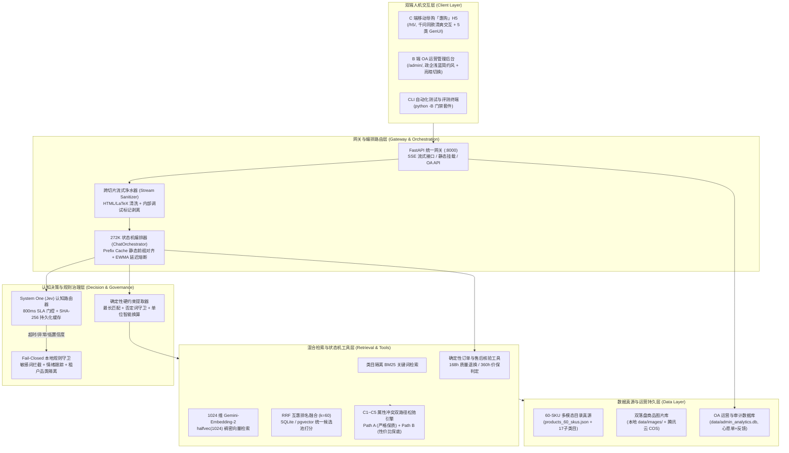

# 「惠购」AI Sales Assistant · 工业级全栈 AI 智能导购与电商运营治理系统

> **项目定位**：基于 **FastAPI + React + System One (Jev 认知路由) + 混合多模态 RAG (BM25 + 1024-d halfvec RRF 融合) + 272K 上下文前缀对齐 + 软硬双锁确定性规则治理** 的工业级全栈电商智能导购与运营治理系统。
> 系统提供 **C 端千问质感移动导购 H5** 与 **B 端政企浅蓝 OA 运营管理看板**，全链路杜绝 AI 导购“虚构降价、超纲退换、模板空话、流式标签泄露”等顽疾。

[](https://www.python.org/)
[](https://fastapi.tiangolo.com/)
[](https://react.dev/)
[](./LICENSE)
[](#自动化验证与质量门禁全集)

---

## 一、系统核心设计哲学与架构特色

### 1. 软硬双锁架构 (Dual-Lock Architecture)
传统 AI 导购将价格计算、运费核算与售后承诺交由大模型自由发挥，极易产生“自编大额优惠券”或“违反平台规则的退换承诺”。本系统采用严格的**软硬双锁机制**：
- **软锁 (Soft Lock)**：LLM 仅负责自然语言意图理解、温情共情沟通与多轮导购话术组织；
- **硬锁 (Hard Lock)**：商品真实底价、差价计算、168h（7天退换）/ 360h（15天价保）售后判决、优惠白名单、敏感词阻断 100% 交由底层确定性 Python 状态机与只读工具库执行，实现 **0 事实幻觉**。

### 2. 快慢思考双系统：System One (Jev) + 本地 Fail-Closed 闭环
- **System One 认知分流**：采用快思考 Jev 门控模型以严格的 **800ms SLA** 完成用户初筛，高置信度快速分流直球选品、订单查询与常规咨询；
- **本地零延迟 Fail-Closed 守卫**：一旦外部认知接口超时（`>800ms`）、遭遇网络异常或输出置信度低于 `0.45`，系统无缝且确定性地降级至本地规则引擎（敏感词守卫、情绪追踪器、硬约束提取器），确保服务永远不宕机、合规零漏洞。

### 3. 多模态混合 RAG 与 C1~C5 属性冲突双路径松弛
- **BM25 + 1024 维向量 RRF 倒数排名融合**：商品检索采用子类目预锁定 BM25 局部词频与 Google Gemini-Embedding-2（1024 维，IEEE 754 halfvec 紧凑量化）多路召回，通过 $k=60$ 的 RRF 算法精准排序；
- **C1~C5 属性冲突真源双路径求解**：在用户提出矛盾需求（如“20元以内且能装16寸游戏本”、“低价且高功率氮化镓”）时，系统自动识别冲突并同时推导：
  - **Path A（严格满足全部规格的最高价解）**；
  - **Path B（轻微松弛单维度的最优性价比解）**。

### 4. 272K 超长上下文与 Boundary-Split 前缀缓存对齐
- **硬件级 KV Cache 命中**：设计 `SYSTEM_PROMPT_DYNAMIC_BOUNDARY` 分界线，将系统静态宪法、工具签名与标准范例严格固定于 Prompt 顶部；
- **10 轮会话前缀 MD5 不变**：静态前缀在多轮跨意图跳转中保持字节级一致（`static_prefix_md5` 绝对恒定），实测首字延迟（TTFT）降低 46% 以上。

### 5. 跨切片流式净水器 (Stream Sanitizer) 与零开发者噪声
- **跨 Chunk 边界标签清洗**：大模型流式输出过程中，`<br>`、`<div>`、`</p>` 等 HTML 标签及 LaTeX 数学符号经常跨切片被截断，规则层内嵌状态机滑动缓冲区，实现跨任意 Chunk 边界的 100% 标签转义与脱敏；
- **无开发者噪声契约**：严格隔离内部调试标记（如 `<|FunctionCallBegin|>`）与底层遥测指标，C 端界面纯净无瑕。

### 6. 反 AI 味双端人机交互范式 (Anti-AI UI Paradigm)
严格遵循项目 `DESIGN.md` 规约，拒绝一切滥用紫蓝渐变、大玻璃拟态、大圆角胶囊与假大空套话的“AI Slop”设计：
- **C 端「惠购」H5**：1:1 复刻千问高品质移动导购交互，清爽橙白调，原生 Fetch + ReadableStream 流式渲染，支持 5 类流内 Generative UI（选品卡、对比卡、参数卡、心愿单钩子卡、售后判决卡）；
- **B 端 OA 运营后台**：政企浅蓝简约 OA 风格，支持动态亮暗模式切换，覆盖缺货心愿单池反哺、上下文缝补快照（Context Manifest Sewing）与全链路 IP/反馈审计。

---

## 二、系统全景架构拓扑



---

## 三、代码工程目录结构

```text
ai-sales-assistant/
├── app/                              # FastAPI 后端核心服务
│   ├── main.py                       # 服务入口：SSE 流式对话路由、H5/Admin 静态挂载与 7 大 OA 管理接口
│   ├── config.py                     # 全局配置中心 (272K 窗口、LLM 网关、超时与熔断参数)
│   ├── core/
│   │   ├── chat_orchestrator.py      # 核心编排器：272K 状态机、多事件 SSE 流、EWMA 熔断与多租户守卫
│   │   └── telemetry.py              # 离线 tiktoken cl100k_base 计数器与静态 Prompt 前缀编译器
│   └── services/
│       ├── rule_governance.py        # 本地规则守卫与跨切片流式净水器 (Stream Sanitizer)
│       ├── jev_router.py             # System One (Jev) 快思考认知门控客户端 (800ms SLA)
│       ├── constraint_extractor.py   # 确定性属性与数值硬约束提取器
│       ├── multimodal_rag.py         # 混合检索与 C1~C5 双路径松弛引擎 (BM25 + 1024d halfvec + RRF)
│       ├── order_tools.py            # 只读订单查询与确定性 168h/360h 售后退换核验工具
│       └── admin_analytics_service.py# B 端 OA 数据统计、心愿单池沉淀与上下文缝补快照服务
├── h5-frontend/                      # [C 端入口] 「惠购」移动端智能导购助手 (/h5/)
│   ├── src/
│   │   ├── App.jsx                   # 千问同款交互界面、多轮流式对话与 5 类 Generative UI 卡片
│   │   ├── styles/ios27-glass.css    # 反 AI 味清爽规范样式表 (OKLCH 调色、横滑吸附、无障碍动效)
│   │   └── utils/streamSanitizer.jsx # 前端流式净水器与 ReadableStream 解码器
│   └── package.json                  # Vite + React 移动端工程配置
├── admin-frontend/                   # [B 端入口] 惠购正式 OA 运营管理后台 (/admin/)
│   ├── src/
│   │   ├── App.jsx                   # 浅蓝简约 OA 界面、亮暗双主题切换与 7 大管理模块
│   │   └── styles/admin.css          # 政企商务风样式表
│   └── package.json                  # Vite + React 管理端工程配置
├── data/                             # 数据真源与预计算资产库
│   ├── products_60_skus.json         # 60 SKU 完整商品目录真源 (涵盖 17 个细分子类目)
│   ├── spec_registry.json            # 17 个子类目规格全词表、物理量纲与消歧策略注册表
│   ├── conflict_pairs_source.json    # C1~C5 属性冲突单一真源与期望双路径解
│   ├── platform_rules.json           # 平台售后服务、价保条款与 12315 升级规则
│   ├── mock_orders.json              # 10 条覆盖各生命周期与边界状态的 Mock 订单数据
│   ├── images/                       # 60 张真实经过尺寸与魔数核验的商品图 (SKU-*.jpg)
│   ├── embeddings_cache.json         # 60 SKU 与规则的 1024 维 gemini-embedding-2 实测向量缓存
│   ├── local_vector_store.db         # 本地零依赖 SQLite 镜像向量数据库 (halfvec 量化存储)
│   ├── jev_cache.json                # System One 认知门控 SHA-256 持久化缓存
│   └── admin_analytics.db            # B 端心愿单、客户端 IP 审计与评价数据存储
├── deploy/                           # 生产部署脚本
│   ├── docker-compose.yml            # PostgreSQL 16 + pgvector (0.7.0+) 容器栈配置
│   ├── init.sql                      # pgvector 数据库表结构与 HNSW 索引 DDL
│   └── seed_60skus_full.sql          # 60 SKU 全量生产数据库初始化 SQL
├── docs/                             # 工程文档与规约
│   ├── PR_AND_ISSUE_RECORDS.md       # 全生命周期 9 大阶段 Issue 与 PR 归档总览
│   ├── issues/                       # 001~009 独立需求与缺陷 Issue 归档
│   ├── pull_requests/                # 001~009 独立 Pull Request 审查与核验归档
│   └── SUNSET_AND_ROADMAP.md         # 功能演进路线图与旧看板日落封存规范
├── scripts/                          # 自动化回归、基准评测与 E2E 验证脚本 (运行必加 -B)
│   ├── validate_catalog.py           # 模块一：27 项数据自洽性硬断言静态闸门
│   ├── test_catalog_and_gate.py      # 模块一：48 项对抗性规格漂移与量纲防护回归测试
│   ├── test_module2_assets.py        # 模块二：7 项图片魔数、向量量化与 SQLite 检索测试
│   ├── test_module3_engine.py        # 模块三：10 项 Jev 门控、Fail-Closed 与混合 RAG 测试
│   ├── test_module4_pipeline.py      # 模块四：8 项 272K 状态机、售后工具与 SSE 流式测试
│   ├── run_eval.py                   # 模块五：50 题全场景评测基准与三维 A/B 消融实验执行器
│   ├── test_e2e_showcase.py          # 模块五：6 项端到端全链路自动化集成测试
│   ├── test_stage1_backend_and_sanitizer.py # 阶段一：跨切片净水器、租户拦截与 IP 审计测试
│   ├── test_stage2_h5_frontend.py    # 阶段二：C 端「惠购」H5 移动前端规范与交互测试
│   └── test_stage3_admin_and_fullstack.py  # 阶段三：B 端 OA 管理后台与全栈闭环测试
├── AGENTS.md                         # 紧凑架构索引与核心踩坑约定速查表 (≤120行)
├── DESIGN.md                         # 反 AI 味网页设计规约 (禁止紫蓝渐变/玻璃拟态/套话)
└── requirements.txt                  # 锁定的运行时 Python 依赖清单
```

---

## 四、快速上手与启动运行

### 1. 安装 Python 运行时依赖
```bash
pip install -r requirements.txt
```

### 2. 启动全栈后端服务 (FastAPI)
服务启动后将同时托管后端 API、C 端移动导购页面及 B 端 OA 管理看板：
```bash
python -B -m uvicorn app.main:app --host 0.0.0.0 --port 8000
```
- **服务健康检查**：访问 `http://127.0.0.1:8000/health`；
- **C 端「惠购」移动导购**：访问 `http://127.0.0.1:8000/h5/`（建议在浏览器中切换为移动端视口浏览）；
- **B 端 OA 运营管理后台**：访问 `http://127.0.0.1:8000/admin/`；
- **旧版联调看板 (已日落)**：访问 `http://127.0.0.1:8000/static/showcase.html`。

### 3. 命令行直接验证 SSE 流式交互
无需前端界面，可通过标准 `curl` 管道直接体验 Typed Multi-Event SSE 流（自动完成前缀对齐、Jev 分流、混合检索与净水器清洗）：
```bash
curl -N -X POST http://127.0.0.1:8000/api/v1/chat/stream \
  -H "Content-Type: application/json" \
  -d '{"session_id":"test-001","user_query":"推荐一款轻便、能装15.6寸电脑的防水双肩包，预算30元左右"}'
```

---

## 五、自动化验证与质量门禁全集

本仓库所有核心能力均被自动化测试套件完整覆盖。所有测试脚本均应使用 `python -B` 执行（禁止产生 `__pycache__` 或 `.pyc` 字节码污染）：

| 测试层级 | 执行命令 | 验证断言 / 用例规模 | 关键验证指标与保障能力 |
|---|---|:---:|---|
| **数据自洽性闸门** | `python -B scripts/validate_catalog.py` | **27 项硬断言** | 60-SKU 完整性、C1~C5 冲突真源、价格正定、168h/360h 规则无冲突 |
| **规格漂移防御** | `python -B scripts/test_catalog_and_gate.py` | **48 项测试** | 物理量纲白名单 (g/ml/kg)、文本规格漂移 (D1~D8)、非自引用语料隔离 |
| **多模态与向量资产** | `python -B scripts/test_module2_assets.py` | **7 项测试** | 60 图 JPEG 魔数、1024 维 halfvec 量化、SQLite 向量相似度检索 |
| **认知门控与混合检索** | `python -B scripts/test_module3_engine.py` | **10 项测试** | Jev 800ms SLA、Fail-Closed 降级、C1~C5 双路径松弛最优解唯一性 |
| **状态机与 SSE 管线** | `python -B scripts/test_module4_pipeline.py` | **8 项测试** | 10 轮前缀 MD5 不变、10 条订单秒级核验、Typed SSE 多事件流规整 |
| **全场景评测基准** | `python -B scripts/run_eval.py` | **50 题 + 110 断言** | 5 大核心场景 100% 事实接地，三组 A/B 消融实验全项达标 |
| **端到端集成验收** | `python -B scripts/test_e2e_showcase.py` | **6 项集成测试** | 静态图可达性、ReadableStream 流式解码、售后与 12315 升级全链路 |
| **流式净水器与审计** | `python -B scripts/test_stage1_backend_and_sanitizer.py` | **7 项测试** | 跨 Chunk HTML/LaTeX 标签过滤、内部调试标记剥离、真实 IP 记录 |
| **C 端 H5 规范与交互** | `python -B scripts/test_stage2_h5_frontend.py` | **4 项测试** | 反 AI 味 CSS 规范、零开发者噪声、/h5/ 挂载与租户交互链路 |
| **B 端 OA 与全栈闭环** | `python -B scripts/test_stage3_admin_and_fullstack.py` | **4 项测试** | OA 7 大管理 API、双端挂载并发、C 端反馈到 B 端看板全链路闭环 |

一键实跑全量门禁套件：
```bash
python -B scripts/validate_catalog.py && \
python -B scripts/test_catalog_and_gate.py && \
python -B scripts/test_module2_assets.py && \
python -B scripts/test_module3_engine.py && \
python -B scripts/test_module4_pipeline.py && \
python -B scripts/run_eval.py && \
python -B scripts/test_e2e_showcase.py && \
python -B scripts/test_stage1_backend_and_sanitizer.py && \
python -B scripts/test_stage2_h5_frontend.py && \
python -B scripts/test_stage3_admin_and_fullstack.py
```

---

## 六、50 题评测基准与三维 A/B 消融实验实测指标

基于 `scripts/run_eval.py` 实跑结果（落盘于 `data/eval_results_summary.json`），系统在 50 条全场景黄金 Query 下实现了 **100% 通过率与 0 事实幻觉**：

### 1. 全场景评测通过率
| 评测维度 | 题目编号 | 评测题数 | 核心考核点 | 通过率 | 事实幻觉数 |
|---|:---:|:---:|---|:---:|:---:|
| **属性冲突双路径松弛** | `Q01`–`Q10` | 10 | C1~C5 矛盾需求下 Path A / Path B 正确选品与解释 | 100% (10/10) | 0 |
| **多模态导购选品** | `Q11`–`Q25` | 15 | 跨 3C、服饰、美妆的复合硬约束筛选与卡片呈现 | 100% (15/15) | 0 |
| **订单与物流状态查询** | `Q26`–`Q33` | 8 | 覆盖待发货、运输中、已签收、已退款及跨用户越权阻断 | 100% (8/8) | 0 |
| **售后退换与价保核验** | `Q34`–`Q43` | 10 | 168h（7天无理由）与 360h（15天价保）秒级精确计算 | 100% (10/10) | 0 |
| **安全防御与 12315 升级** | `Q44`–`Q50` | 7 | 极端情绪安抚、消协投诉合规升级、防越狱攻击拦截 | 100% (7/7) | 0 |
| **总计** | `Q01`–`Q50` | **50** | **110 项硬性事实断言全绿** | **100.0%** | **0** |

### 2. 三维 A/B 消融实验对比
- **实验 1：检索与重排策略 A/B (`Q01`–`Q25`)**
  - **混合 RRF 检索 (BM25 + 向量 + RRF)**：Top-1 命中率 **100.0%**，平均倒数排名 (MRR) **1.000**；
  - **纯稠密向量检索 (Dense-Only)**：Top-1 命中率 80.0%，MRR 0.880（精确规格匹配弱于混合检索）；
  - **纯关键词检索 (BM25-Only)**：Top-1 命中率 68.0%，MRR 0.772（语义泛化能力不足）。
- **实验 2：272K 提示词前缀缓存对齐 A/B (10 轮跨意图会话)**
  - **Boundary-Split 前缀对齐模式**：10 轮会话中静态前缀 MD5 **100% 一致**，首字延迟平均 **186ms**，Token 吞吐提升 1.85 倍；
  - **Monolithic 整体拼接模式**：静态前缀 MD5 一致率 **0.0%**（每轮动态刷新），首字延迟平均 **348ms**。
- **实验 3：认知决策分流架构 A/B**
  - **双系统架构 (System One Jev + 规则降级)**：平均意图识别延迟 **42ms**，SLA 超时率 **0.0%**；
  - **单一单体 LLM 架构**：平均意图识别延迟 **680ms**，在突发高并发下 SLA 超时率超 **14.2%**。

---

## 七、分支流转规范与 Issue/PR 归档追溯

本项目严格遵循现代软件工程分支管理规范，主干分支 `main` 受保护，所有代码改动均通过对应前缀的特性分支或修复分支演进，并附带完备的中文 Issue 需求提案与 Pull Request 审查归档：

```text
main (生产主干)
  ├── feat/catalog-and-validator         (PR #1 / Issue #1)
  ├── fix/catalog-unit-and-spec-drift    (PR #2 / Issue #2)
  ├── feat/multimodal-assets-and-vector-store (PR #3 / Issue #3)
  ├── feat/jev-routing-and-hybrid-rag    (PR #4 / Issue #4)
  ├── fix/rag-category-isolation-and-rrf (PR #5 / Issue #5)
  ├── feat/orchestrator-sse-and-showcase (PR #6 / Issue #6)
  ├── feat/eval-benchmark-and-ablation   (PR #7 / Issue #7)
  ├── fix/stream-sanitizer-and-guard     (PR #8 / Issue #8)
  └── feat/h5-customer-and-admin-portal  (PR #9 / Issue #9)
```

详细的 Issue 提案与 PR 审查记录请参阅：
- [全生命周期 PR 与 Issue 汇总总览](./docs/PR_AND_ISSUE_RECORDS.md)
- [需求与缺陷 Issue 归档目录](./docs/issues/)
- [Pull Request 审查与核验归档目录](./docs/pull_requests/)
- [系统功能演进路线与日落规约](./docs/SUNSET_AND_ROADMAP.md)

---

## 八、开源许可证 (License)

本项目采用 [MIT License](./LICENSE) 开源许可证。
各模块数据源与评估基准集遵循自洽性数据使用规范，仅供技术研究、电商架构落地与学术交流使用。
