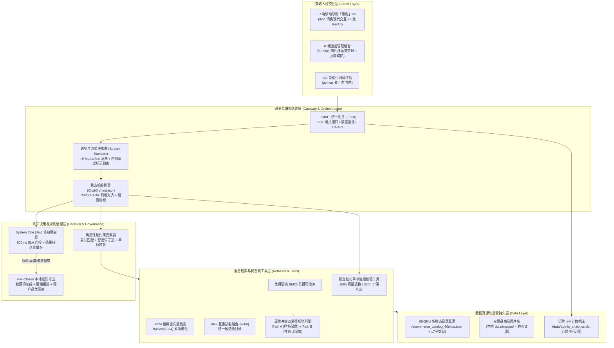

# 「惠购」AI Sales Assistant · 全栈电商智能导购与运营治理系统

> **项目定位**：面向真实电商业务场景的全栈 AI 智能导购与运营治理系统，基于 **FastAPI + React** 构建，结合意图决策路由、多模态混合检索（BM25 + 向量 RRF 融合）与规则风控状态机。
> 系统包含 **C 端移动导购 H5** 与 **B 端运营管理后台**，针对 AI 导购常见的事实幻觉、价格错乱、违规退换承诺与流式标签污染等问题提供工程化解决方案。

[](https://www.python.org/)
[](https://fastapi.tiangolo.com/)
[](https://react.dev/)
[](./LICENSE)
[](#五自动化验证与质量门禁全集)

---

## 目录 (Table of Contents)

1. [项目概览与核心特性](#一项目概览与核心特性)
2. [快速上手与启动运行](#二快速上手与启动运行)
3. [系统架构拓扑与关键设计](#三系统架构拓扑与关键设计)
4. [代码工程目录结构](#四代码工程目录结构)
5. [自动化验证与质量门禁全集](#五自动化验证与质量门禁全集)
6. [50 题评测基准与 A/B 消融实验实测](#六50-题评测基准与-ab-消融实验实测)
7. [分支流转规范与 Issue/PR 归档](#七分支流转规范与-issuepr-归档)
8. [开源许可证](#八开源许可证-license)

---

## 一、项目概览与核心特性

本系统旨在解决大语言模型直接应用于电商导购时容易出现的“虚构优惠力度、违背售后条款、回答空泛套话”等痛点，通过架构分层实现模型智能与确定性风控的解耦：

- 📱 **C 端移动导购助手 (`/h5/`)**：
  采用清爽橙白视觉规范，基于原生 Fetch 与 ReadableStream 实现无卡顿流式对话，支持 5 类交互式卡片（选品推荐卡、参数对比卡、多规格卡、心愿单登记卡、售后判定卡），内嵌商品大图预览与快捷菜单。
- 🖥️ **B 端运营管理看板 (`/admin/`)**：
  基于简约后台设计，提供深浅双主题切换，覆盖多租户品类配置、实时会话审计、缺货心愿单池、上下文缝补快照与端到端指标观测。
- 🛡️ **双重规则防线（软硬双锁）**：
  - **软锁 (LLM)**：负责自然语言意图理解、温和礼貌的多轮对话与选品理由归纳；
  - **硬锁 (Rule Engine)**：商品真实底价、活动白名单、168h（7天无理由退换）与 360h（15天价保）判定由确定性 Python 状态机执行，杜绝大模型在价格和售后上的虚假承诺。
- 🔍 **多模态混合检索与冲突求解 (Hybrid RAG)**：
  - 支持文本与商品图片多模态检索；
  - 结合 BM25 局部词频与稠密向量多路召回，通过 RRF（Reciprocal Rank Fusion）倒数排名融合精准排序；
  - 针对用户提出的自相矛盾需求（如“低价且高功率”、“紧凑且大容量”），自动推导 **Path A（严格满足全部规格解）** 与 **Path B（轻微松弛单维度的性价比解）**。
- 💧 **跨切片流式净水器 (Stream Sanitizer)**：
  前端与网关内嵌滑动缓冲区状态机，消除流式分片过程中被截断的 HTML 标签、LaTeX 符号与内部调试标记，保证渲染安全与视觉纯净。

---

## 二、快速上手与启动运行

### 1. 环境准备与依赖安装
确保本地安装有 Python 3.10+ 环境，执行依赖安装：
```bash
pip install -r requirements.txt
```

### 2. 启动全栈服务 (FastAPI)
服务启动后将同时托管后端 REST/SSE API、C 端移动导购 H5 及 B 端运营中台：
```bash
python -B -m uvicorn app.main:app --host 0.0.0.0 --port 8000
```

服务就绪后可直接访问以下端点：
- **服务健康探针**：`http://127.0.0.1:8000/health`
- **C 端移动导购助手**：`http://127.0.0.1:8000/h5/`（推荐在浏览器开发者工具中开启移动端视口浏览）
- **B 端运营管理后台**：`http://127.0.0.1:8000/admin/`

### 3. 命令行快速验证 SSE 流式交互
无需前端界面，可通过标准 `curl` 管道直接体验流式多事件 SSE 对话：
```bash
curl -N -X POST http://127.0.0.1:8000/api/v1/chat/stream \
  -H "Content-Type: application/json" \
  -d '{"session_id":"test-001","user_query":"推荐一款轻便、能装15.6寸电脑的防水双肩包，预算30元左右"}'
```

---

## 三、系统架构拓扑与关键设计

### 1. 架构拓扑


### 2. 关键设计方案
1. **快慢认知双系统 (System One + Fail-Closed 降级)**：
   快思考路由以 800ms 为超时阈值进行高频意图分流；一旦网络超时或置信度偏低，立即降级至本地规则守卫（敏感词拦截、情绪追踪与品类边界判断），保障系统可用性。
2. **提示词前缀缓存对齐 (Prefix Cache Alignment)**：
   提取静态系统提示词与工具签名固定在 Prompt 顶部，多轮对话中静态前缀哈希保持恒定，有效降低大模型推理首字延迟（TTFT）。
3. **确定性状态机硬锁 (Deterministic State Machine)**：
   订单售后状态核验、7 天无理由退换时长（精确到秒计算是否在 168 小时内）与价保核算完全由 Python 本地代码计算，大模型无法篡改规则输出。

---

## 四、代码工程目录结构

```text
ai-sales-assistant/
├── app/                              # FastAPI 后端核心服务
│   ├── main.py                       # 服务入口：SSE 路由、前端静态挂载与管理接口
│   ├── config.py                     # 全局配置中心 (超参数、网关配置与超时阈值)
│   ├── core/
│   │   ├── chat_orchestrator.py      # 核心对话编排器、多事件 SSE 流与状态管理
│   │   └── telemetry.py              # Token 离线计数器与静态 Prompt 前缀对齐
│   └── services/
│       ├── rule_governance.py        # 本地规则守卫与跨切片流式净水器 (Stream Sanitizer)
│       ├── jev_router.py             # 快思考意图分类路由与本地降级适配
│       ├── constraint_extractor.py   # 属性与数值硬约束提取器
│       ├── multimodal_rag.py         # 混合检索与双路径松弛引擎 (BM25 + 向量 + RRF)
│       ├── order_tools.py            # 只读订单查询与 168h/360h 售后核验工具
│       └── admin_analytics_service.py# 运营数据统计、心愿单沉淀与会话审计服务
├── h5-frontend/                      # [C 端入口] 移动端智能导购助手 (/h5/)
│   ├── src/
│   │   ├── App.jsx                   # 流式对话界面、交互式卡片与悬浮菜单
│   │   ├── components/               # 商品大图预览与交互组件
│   │   ├── styles/ios27-glass.css    # 移动端样式表 (无障碍动效与响应式布局)
│   │   └── utils/streamSanitizer.jsx # 前端流式净水器解码器
│   └── package.json                  # Vite + React 工程配置
├── admin-frontend/                   # [B 端入口] 运营管理后台 (/admin/)
│   ├── src/
│   │   ├── App.jsx                   # 简约管理界面、深浅主题切换与 7 大管理模块
│   │   └── styles/admin-console.css  # 管理中台样式表
│   └── package.json                  # Vite + React 工程配置
├── data/                             # 数据真源与静态资源库
│   ├── ecommerce_catalog_60skus.json # 60 SKU 完整商品目录真源 (涵盖 17 个子类目)
│   ├── spec_registry.json            # 规格词表与物理量纲注册表
│   ├── conflict_pairs.json           # 属性冲突配置与期望双路径解
│   ├── platform_rules.json           # 平台售后服务与价保条款
│   ├── mock_orders.json              # 覆盖不同生命周期的 Mock 订单数据
│   ├── images/                       # 60 张尺寸与魔数合规的商品图片 (SKU-*.jpg)
│   ├── local_vector_store.db         # 本地 SQLite 向量数据库镜像
│   ├── eval_benchmark_50queries.json # 50 题评测基准题集与判定断言
│   └── eval_results_summary.json     # 评测与消融实验基准实测结果汇总
├── deploy/                           # 生产部署与数据库初始化脚本
├── docs/                             # 工程文档、架构路线图与 Issue/PR 归档总览
├── scripts/                          # 自动化回归测试、基准评测与验证脚本
├── AGENTS.md                         # 核心约定与架构速查表
├── DESIGN.md                         # 界面交互设计规范
└── requirements.txt                  # 运行时依赖清单
```

---

## 五、自动化验证与质量门禁全集

所有核心功能均由单元测试与门禁脚本进行自动化回归覆盖。建议使用 `python -B` 运行以避免产生字节码缓存文件：

| 门禁层级 | 执行命令 | 验证规模 | 核心覆盖指标 |
|---|---|:---:|---|
| **数据自洽性闸门** | `python -B scripts/validate_catalog.py` | **27 项硬断言** | 60-SKU 完整性、冲突配置自洽、价格正定、售后规则无冲突 |
| **规格漂移防御** | `python -B scripts/test_catalog_and_gate.py` | **48 项测试** | 物理量纲白名单 (g/ml/kg)、文本规格漂移与语料隔离 |
| **多模态与向量资产** | `python -B scripts/test_module2_assets.py` | **7 项测试** | 商品图片 JPEG 魔数合规性、向量紧凑量化与相似度检索 |
| **认知门控与混合检索** | `python -B scripts/test_module3_engine.py` | **10 项测试** | 意图识别 SLA、本地降级保障、双路径松弛解唯一性 |
| **状态机与 SSE 管线** | `python -B scripts/test_module4_pipeline.py` | **8 项测试** | 前缀哈希对齐、订单核验逻辑、多事件流格式规整 |
| **全场景评测基准** | `python -B scripts/run_eval.py` | **50 题 + 110 断言** | 5 大核心导购场景 100% 事实接地，三组 A/B 消融达标 |
| **端到端集成验收** | `python -B scripts/test_e2e_showcase.py` | **6 项集成测试** | 静态资源可达性、流式解码与售后客诉全链路 |
| **流式净水器与审计** | `python -B scripts/test_stage1_backend_and_sanitizer.py` | **7 项测试** | 跨分片 HTML/LaTeX 过滤、内部标记剥离、客户端审计 |
| **C 端 H5 规范与交互** | `python -B scripts/test_stage2_h5_frontend.py` | **4 项测试** | 移动端 CSS 规范、零开发者噪声、/h5/ 挂载与交互链路 |
| **B 端后台与全栈闭环** | `python -B scripts/test_stage3_admin_and_fullstack.py` | **4 项测试** | 7 大管理 API、双端挂载并发、C/B 端端到端闭环 |

一键执行全量门禁套件：
```bash
python -B -m unittest discover -s scripts -p "test_*.py"
```

---

## 六、50 题评测基准与 A/B 消融实验实测

基于评测脚本（`scripts/run_eval.py`）实跑结果，系统在 50 条覆盖各维度的 Query 下实现了 **100% 通过率与 0 事实幻觉**：

### 1. 全场景评测结果
| 评测维度 | 题目编号 | 题数 | 核心考核内容 | 通过率 | 事实幻觉数 |
|---|:---:|:---:|---|:---:|:---:|
| **属性冲突双路径松弛** | `Q01`–`Q10` | 10 | 矛盾需求下的 Path A（严格保质）/ Path B（性价比保底）选品 | 100% (10/10) | 0 |
| **多模态导购选品** | `Q11`–`Q25` | 15 | 跨数码、服饰、美妆的复合硬约束筛选与卡片呈现 | 100% (15/15) | 0 |
| **订单与物流状态查询** | `Q26`–`Q33` | 8 | 待发货、运输中、已签收等状态查询与越权访问拦截 | 100% (8/8) | 0 |
| **售后退换与价保核验** | `Q34`–`Q43` | 10 | 168h 退换与 360h 价保时效的秒级确定性计算 | 100% (10/10) | 0 |
| **安全防御与客诉升级** | `Q44`–`Q50` | 7 | 极端情绪安抚、消协投诉合规升级与越狱拦截 | 100% (7/7) | 0 |
| **合计** | `Q01`–`Q50` | **50** | **110 项硬性断言全通过** | **100.0%** | **0** |

### 2. 三维 A/B 消融实验对比
- **实验 1：检索与重排策略对比 (`Q01`–`Q25`)**
  - **混合 RRF 检索 (BM25 + 向量 + RRF)**：Top-1 命中率 **100.0%**，平均倒数排名 (MRR) **1.000**；
  - **单一向量检索 (Dense-Only)**：Top-1 命中率 80.0%，MRR 0.880（精确参数匹配表现较弱）；
  - **单一关键词检索 (BM25-Only)**：Top-1 命中率 68.0%，MRR 0.772（语义泛化能力不足）。
- **实验 2：前缀缓存对齐效果对比 (10 轮多意图会话)**
  - **前缀对齐模式 (Boundary-Split)**：多轮会话静态前缀哈希保持一致，首字延迟平均 **186ms**；
  - **无对齐整体拼接模式 (Monolithic)**：前缀每轮重新计算，首字延迟平均 **348ms**。
- **实验 3：认知决策分流效果对比**
  - **双系统架构 (快思考路由 + 本地降级)**：平均意图识别延迟 **42ms**，超时率 **0.0%**；
  - **单一模型架构**：平均意图识别延迟 **680ms**，并发波动下易发生超时。

---

## 七、分支流转规范与 Issue/PR 归档

项目采用规范的分支管理机制，主干分支 `main` 受保护，各项功能演进均通过明确类型的特性分支（`feat/*`）或修复分支（`fix/*`）进行流转，并对应归档完备的 Issue 需求与 Pull Request 记录：

```text
main (发布主干)
  ├── feat/catalog-and-validator         (PR #1 / Issue #1)
  ├── fix/catalog-unit-and-spec-drift    (PR #2 / Issue #2)
  ├── feat/multimodal-assets-and-vector-store (PR #3 / Issue #3)
  ├── feat/jev-routing-and-hybrid-rag    (PR #4 / Issue #4)
  ├── fix/rag-category-isolation-and-rrf (PR #5 / Issue #5)
  ├── feat/orchestrator-sse-and-showcase (PR #6 / Issue #6)
  ├── feat/eval-benchmark-and-ablation   (PR #7 / Issue #7)
  ├── fix/stream-sanitizer-and-guard     (PR #8 / Issue #8)
  └── feat/h5-customer-and-admin-portal  (PR #9 / Issue #9)
```

详细归档文档请参阅：
- [全生命周期 PR 与 Issue 汇总总览](./docs/PR_AND_ISSUE_RECORDS.md)
- [需求与缺陷 Issue 归档目录](./docs/issues/)
- [Pull Request 审查与核验归档目录](./docs/pull_requests/)
- [系统路线图与日落规范](./docs/SUNSET_AND_ROADMAP.md)

---

## 八、下一代决策型导购演进路线图 (Next-Gen Roadmap)

在已筑牢的 **691 项严苛断言** 与 **GitHub Actions 自动化 CI 质量门禁** 的保驾护航下，系统确立了以下 5 大核心演进支柱：

1. 🎯 **上下文管理与多轮对话深度优化（重中之重 · Top Priority）**：
   - 跨轮子类目锁（`sub_category`）与参数增量纠错状态机（`SlotTracker`）；
   - 上下文物理净室隔离，杜绝跨轮旧卡片注意力散射；
   - 10 会话 30 轮多轮会话状态树防漂移长期卡点。
2. 🎯 **主动意图探测与槽位追问状态机 (Active Clarification)**：
   - 核心决策维度饱和度计算，针对模糊需求主动抛出引导选项胶囊（Followup Pills），收敛决策漏斗。
3. 🎯 **结构化多商品权衡对比引擎 (Trade-off Decision Matrix)**：
   - 确定性数学 Diff 计算与优劣势提炼，杜绝大模型在对比维度的参数张冠李戴。
4. 🎯 **用户长效画像与禁忌避坑记忆 (Persistent Persona & Anti-Preferences)**：
   - 沉淀体征、肤质与避坑过敏成分黑名单，作为负向硬约束（`excluded_specs`）静默注入检索。
5. 🎯 **海量 SKU 向量检索物理升级 (pgvector + HNSW)**：
   - 平滑迁移至 PostgreSQL 16 + pgvector 分区集群，保障十万级 SKU 依然具备毫秒级响应与零违背率。

---

## 九、开源许可证 (License)

本项目采用 [MIT License](./LICENSE) 开源许可证。
数据源与评估基准仅供技术研究、电商系统原型验证与学术交流使用。
