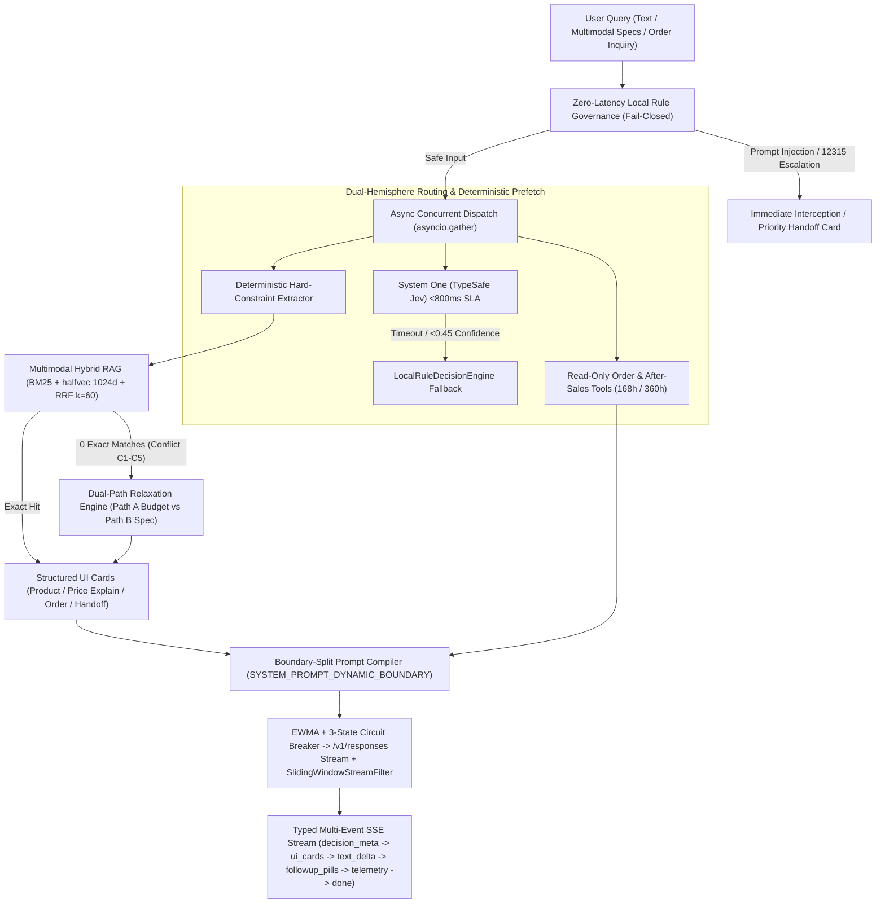

# AI Sales Assistant — Industrial-Grade E-Commerce Shopping & Customer Service Agent

[](./LICENSE)
[](https://www.python.org/)
[](https://fastapi.tiangolo.com/)
[-336791.svg)](https://github.com/pgvector/pgvector)
[](#4-272k-context-window--static-prefix-cache-alignment)

An industrial-grade, zero-hallucination **Multimodal E-Commerce Shopping & Customer Service Agent** (benchmarked against Taobao *"Qianwen"* AI Shopping Assistant). Engineered with a **System One (`Jev`) + Fail-Closed Local Rule Governance** dual-hemisphere decision router, **Multimodal Hybrid RAG (`BM25 + halfvec(1024) + RRF`)**, **Deterministic Dual-Path Constraint Relaxation (`Path A` / `Path B`)**, and **272K Context Prefix-Cache Alignment**.

---

## Architectural Highlights



### 1. System One (`Jev`) + Fail-Closed Local Rule Governance
- **Zero-Latency Safety & Escalation Pre-Filter (`app/services/rule_governance.py`)**: Deterministically intercepts prompt injection, system-prompt extraction attempts, cross-user privacy probes, and high-emotion legal/regulatory complaints (`12315`, counterfeit claims, allergic reactions) **before** any external network call.
- **TypeSafe `Jev` Cognitive Gating (`app/services/jev_router.py`)**: Evaluates 6 structured multi-dimensional routing questions (`IntentType`, `Category`, `ConfidenceGate`, `ToolAction`, `UrgencyLevel`, `EmotionTone`) using strictly English `instructions`/`criteria` and raw user `state` under an `800ms` hard SLA, with deterministic SHA-256 response caching (`data/jev_cache.json`) and instant fallback to `LocalRuleDecisionEngine`.

### 2. Multimodal Hybrid RAG & Dual-Path Constraint Relaxation
- **Dual-Storage Multimodal Assets (`data/products_60_skus.json`)**: 60 curated SKUs across Electronics (`20`), Apparel (`20`), and Beauty (`20`), backed by verified product imagery on both local disk (`data/images/`) and Tencent Cloud COS, paired with calibrated visual descriptions and **Google Vertex AI `gemini-embedding-2` (`1024`-dim)** vectors (`halfvec(1024)` quantized in PostgreSQL `pgvector` and mirrored in `data/local_vector_store.db`).
- **Category-Isolated Hybrid Retrieval (`app/services/multimodal_rag.py`)**: Combines fine-grained Chinese segmentation **BM25 (`k1=1.5, b=0.75`)** with **1024-d Cosine Similarity** via **Reciprocal Rank Fusion (`RRF, k=60`)**, strictly isolated by category to prevent cross-domain term pollution.
- **Deterministic Dual-Path Relaxation (`C1`–`C5`)**: When a user's hard constraints yield zero exact intersection (e.g., *"`<=5000 RMB` + `RTX 4060` + `<=1.5kg` + `17.3-inch` laptop"*), the engine deterministically computes:
  - **Path A (Keep All Specs, Relax Budget)**: Selects the lowest-price SKU satisfying 100% of requested specs and outputs the exact `price_gap`.
  - **Path B (Keep Budget, Relax Non-Core Spec)**: Locks the category and budget ceiling (`price <= budget_max`) and ranks candidates by normalized spec proximity:
    $$\text{SpecProximity}(s, q) = \frac{1}{|K_{\text{num}}|} \sum_{k \in K_{\text{num}}} \max\left(0, 1 - \frac{|v_{s,k} - v_{q,k}|}{\text{span}_k}\right)$$

### 3. Deterministic Order & After-Sales Eligibility Tools
- **Zero-Hallucination Policy Math (`app/services/order_tools.py`)**: Read-only order lookup (`query_order_status`) and rule-grounded after-sales verification (`evaluate_aftersales_eligibility`) across 10 mock orders (`data/mock_orders.json`) and 3 platform rules (`data/platform_rules.json`), enforcing exact hour-level thresholds (`168.0h` 7-day no-reason return, `360.0h` 15-day exchange, hygiene/activation seal exclusions, and deterministic price-protection compensation).

### 4. 272K Context Window & Static Prefix Cache Alignment
- **Byte-Frozen Static Constitution (`app/services/strategy_injector.py`, `app/core/telemetry.py`)**: Splits system prompts via `SYSTEM_PROMPT_DYNAMIC_BOUNDARY`. Everything above the boundary (core identity, zero-hallucination constitution, and tool schemas) remains **100% byte-identical across multi-turn sessions** (`static_prefix_md5 = 4729a6f0dbaa02d0dc8a2c93b0d22b7b`, `1,947` static tokens, `90.26%` static ratio), maximizing KV-cache reuse across a `272,000`-token effective context window measured offline via `tiktoken` (`cl100k_base`).
- **EWMA Latency Router, Lock-Free Circuit Breaker & Sliding-Window Stream Filter (`app/core/chat_orchestrator.py`)**: Tracks node latency via Exponentially Weighted Moving Average ($\alpha=0.3$), trips a 3-state circuit breaker (`CLOSED` / `OPEN` / `HALF_OPEN`) on upstream failures, and scrubs internal sentinels or mathematical formulas across arbitrary chunk boundaries via `SlidingWindowStreamFilter(holdback_chars=64)`.

---

## Repository Structure

```text
ai-sales-assistant/
├── .github/
│   ├── ISSUE_TEMPLATE/
│   │   ├── bug_report.yml               # Bug & audit remediation template
│   │   └── feature_request.yml          # Architectural module & feature template
│   └── PULL_REQUEST_TEMPLATE.md         # Engineering contract PR checklist
├── app/
│   ├── core/
│   │   ├── chat_orchestrator.py         # 272K state machine, EWMA/CB, SSE orchestrator
│   │   └── telemetry.py                 # Offline tiktoken cl100k_base & MD5 alignment
│   ├── services/
│   │   ├── constraint_extractor.py      # Deterministic regex/unit hard-constraint parser
│   │   ├── jev_router.py                # TypeSafe System One (Jev) client & SHA-256 cache
│   │   ├── multimodal_rag.py            # BM25 + halfvec(1024) + RRF & Path A/B relaxation
│   │   ├── order_tools.py               # Read-only order & after-sales policy verifier
│   │   ├── rule_governance.py           # Zero-latency Fail-Closed security & 12315 guard
│   │   └── strategy_injector.py         # SYSTEM_PROMPT_DYNAMIC_BOUNDARY prompt compiler
│   ├── config.py                        # Environment configuration & offline cache bindings
│   └── main.py                          # FastAPI entry point & Typed Multi-Event SSE API
├── data/
│   ├── images/                          # 60 verified SKU product images (JPEG, SHA-256 checked)
│   ├── tiktoken_cache/                  # Offline cl100k_base vocabulary for zero-network startup
│   ├── conflict_pairs.json              # Single source of truth for C1-C5 conflict pairs
│   ├── ecommerce_catalog_60skus.json    # 60 multimodal SKUs & calibrated visual descriptions
│   ├── embeddings_cache.json            # Precomputed 1024-d gemini-embedding-2 vectors
│   ├── eval_benchmark_50queries.json    # 50-query multi-scenario evaluation benchmark
│   ├── image_manifest.json              # Local & Tencent Cloud COS dual-storage manifest
│   ├── jev_cache.json                   # Pre-warmed System One Jev routing responses
│   ├── local_vector_store.db            # Self-contained SQLite + halfvec(1024) mirror store
│   ├── mock_orders.json                 # 10 mock orders with ground-truth eligibility
│   ├── platform_rules.json              # 3 structured platform after-sales policies
│   └── spec_registry.json               # 17-subcategory numeric & enum spec registry
├── deploy/
│   ├── docker-compose.yml               # PostgreSQL 16 + pgvector deployment
│   ├── init.sql                         # halfvec(1024) HNSW index DDL & schema
│   └── seed_60skus_full.sql             # Full 60-SKU + halfvec(1024) + orders SQL seed
├── scripts/
│   ├── generate_catalog.py              # Deterministic catalog & conflict pair generator
│   ├── validate_catalog.py              # 27-assertion static data & policy gate
│   ├── fetch_and_upload_images.py       # Bing image fetcher, validator & COS uploader
│   ├── build_embeddings.py              # Vertex AI gemini-embedding-2 (1024-d) builder
│   ├── seed_database.py                 # Dual PostgreSQL pgvector & SQLite seeder
│   ├── run_eval.py                      # 50-query benchmark & 3-dimension A/B ablation runner
│   ├── test_catalog_and_gate.py         # 48 unit & adversarial gate tests (Module 1)
│   ├── test_module2_assets.py           # 7 multimodal image, COS & vector store tests (Module 2)
│   ├── test_module3_engine.py           # 10 Jev, Rule Governance & Hybrid RAG tests (Module 3)
│   ├── test_module4_pipeline.py         # 8 orchestrator, prefix-MD5 & SSE pipeline tests (Module 4)
│   └── test_e2e_showcase.py             # End-to-end showcase, static assets & SSE verifier (Module 5)
├── static/
│   └── showcase.html                    # Single-page interactive workbench (POST fetch + ReadableStream)
├── .env.example                         # Sanitized environment variable template
├── LICENSE                              # MIT License
└── requirements.txt                     # Python dependencies
```

---

## Quickstart

### 1. Install Dependencies

```bash
pip install -r requirements.txt
cp .env.example .env
```

> **Offline-Ready by Default**: All 60 product images (`data/images/`), precomputed `gemini-embedding-2` 1024-d embeddings (`data/embeddings_cache.json`), SQLite vector mirror (`data/local_vector_store.db`), System One Jev cache (`data/jev_cache.json`), and `tiktoken` vocabulary (`data/tiktoken_cache/`) are bundled in the repository. The system runs out of the box even without external API keys.

### 2. Run the Interactive Showcase Server

```bash
uvicorn app.main:app --host 127.0.0.1 --port 8000
```

Open **`http://127.0.0.1:8000/static/showcase.html`** in your browser to explore:
- **Conflict Relaxation (`C1`–`C5`)**: Side-by-side `Path A` (budget expansion) vs. `Path B` (spec trade-off) cards with transparent `price_explain_card` breakdowns;
- **Order & After-Sales Verification**: Real-time lookup for `ORD-20260301-001` (7-day return eligible), `ORD-20260301-002` (opened hygiene seal rejection), and `ORD-20260301-009` (price protection claim);
- **12315 Priority Escalation & Security Guard**: Instant Fail-Closed interception and priority human handoff (`SLA <= 30s`);
- **272K Context Telemetry Drawer**: Live `static_prefix_md5` invariance check, token distribution (`static` vs. `dynamic` vs. `history`), and per-stage latency breakdown.

### 3. Test the Typed Multi-Event SSE Stream via CLI

```bash
curl -N -X POST http://127.0.0.1:8000/api/v1/chat/stream \
  -H "Content-Type: application/json" \
  -d '{"session_id":"demo-c1","query":"预算5000以内，想要RTX4060独显、重量1.5kg以内、17.3寸大屏的游戏本"}'
```

The endpoint streams 6 strictly ordered SSE event types over `POST fetch + ReadableStream`:
1. `event: decision_meta` — Routing source (`jev_cache` / `jev_live` / `local_rule_fallback`), intent, confidence, and extracted hard constraints;
2. `event: ui_cards` — Structured `product_card`, `price_explain_card`, `order_card`, `aftersales_card`, or `handoff_card`;
3. `event: text_delta` — Chunk-filtered streaming response deltas;
4. `event: followup_pills` — Context-aware interactive follow-up suggestions;
5. `event: telemetry` — 272K token telemetry, `static_prefix_md5`, and circuit breaker status;
6. `event: done` — Stream completion signal.

---

## Reproducible Verification Suite

Run the deterministic verification gates and test suites (always with `python -B` to prevent bytecode pollution):

```bash
# Module 1: 27 static catalog assertions + 40 adversarial gate unit tests
python -B scripts/validate_catalog.py
python -B scripts/test_catalog_and_gate.py

# Module 2: 60 SKU images (local + COS), 1024-d embeddings & vector store tests
python -B scripts/test_module2_assets.py

# Module 3: System One Jev gating, local rule governance & Hybrid RAG relaxation tests
python -B scripts/test_module3_engine.py

# Module 4: 272K orchestrator, 10-turn static_prefix_md5 invariance & SSE E2E tests
python -B scripts/test_module4_pipeline.py

# Module 5: 50-query benchmark, 110 factual grounding assertions & 3 A/B ablation studies
python -B scripts/run_eval.py
python -B scripts/test_e2e_showcase.py
```

---

## 50-Query Benchmark & Three-Dimension A/B Ablation Results

Reproduced deterministically via `python -B scripts/run_eval.py` (`data/eval_benchmark_50queries.json` $\rightarrow$ `data/eval_results_summary.json`):

- **Overall 50-Query Benchmark Pass Rate**: **`50 / 50 (100.0%)`** across all 5 business scenarios (`conflict_relaxation`: `10/10`, `multimodal_exact_search`: `15/15`, `order_query`: `8/8`, `aftersales_verify`: `10/10`, `safety_and_escalation`: `7/7`).
- **Zero-Hallucination Factual Grounding Gate**: **`110` assertions verified, `0` hallucinations (`0.0%` Hallucination Rate)**.

### Experiment 1 — Retrieval & Reranking Mode A/B (`Q01`–`Q25`)

| Retrieval Configuration | Exact Hit@1 (%) | Exact Hit@3 (%) | Exact MRR | Hard-Constraint Violation (%) $\downarrow$ | Conflict Path A+B Acc (%) $\uparrow$ | Mean Latency (ms) |
|---|---:|---:|---:|---:|---:|---:|
| **BM25-only (Unfiltered Global)** | 88.0% | 100.0% | 0.9200 | **73.85%** | **30.0%** | 17.61 |
| **Dense-only (Unfiltered 1024-d)** | 84.0% | 92.0% | 0.8867 | **75.38%** | **20.0%** | 11.95 |
| **Hard-Filter + BM25-only** | 100.0% | 100.0% | 1.0000 | **0.0%** | **100.0%** | 1.21 |
| **Hard-Filter + Dense-only** | 100.0% | 100.0% | 1.0000 | **0.0%** | **100.0%** | 2.62 |
| **Proposed (SubCat + Hard-Filter + BM25 + halfvec + RRF)** | **100.0%** | **100.0%** | **1.0000** | **0.0%** | **100.0%** | **2.59** |

### Experiment 2 — 272K Prompt Prefix Cache Alignment A/B (10-Turn Multi-Intent Session)

| Prompt Architecture | Static Prefix MD5 | Unique MD5s (10 Turns) | MD5 Stability (%) $\uparrow$ | Static Prefix Tokens | Dynamic Suffix Tokens | Avg Static Ratio (%) | 10-Turn KV Cached Tokens $\uparrow$ |
|---|---|---:|---:|---:|---:|---:|---:|
| **Boundary-Split (Proposed)** | `4729a6f0dbaa02d0dc8a2c93b0d22b7b` | **1 / 10** | **100.0%** | **1,947** | 221 ~ 791 | **78.26%** | **17,523** |
| **Monolithic (Baseline)** | `DRIFTS_EVERY_TURN` | **10 / 10** | **0.0%** | **0** | 1,993 ~ 2,032 | **0.0%** | **0** |

### Experiment 3 — Cognitive Decision Gating Architecture A/B

| Decision Gating Architecture | 50-Query Intent Acc (%) $\uparrow$ | Colloquial Multi-Signal Acc (%) $\uparrow$ | Mean Local/Cached Latency (ms) | `>800ms` SLA Breach (%) $\downarrow$ |
|---|---:|---:|---:|---:|
| **Naive Keyword Baseline** | **76.0%** | **25.0%** | 0.001 | 0.0% |
| **LocalRule-Only Engine (Fail-Closed)** | **94.0%** | **87.5%** | 0.035 | 0.0% |
| **Proposed (Jev System One + Cache + Fail-Closed Fallback)** | **100.0%** | **100.0%** | 0.104 | **0.0%** |

---

## License

Released under the [MIT License](./LICENSE).

